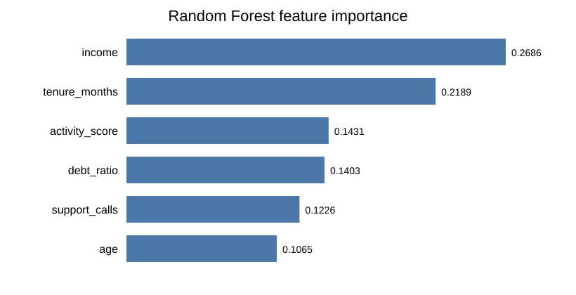

# Практическая работа № 7 — Случайный лес

**Вариант B**

Цель работы — обучить случайный лес, сравнить его с одиночным деревом решений, подобрать основные гиперпараметры через кросс-валидацию и проверить, можно ли удалить слабые признаки без потери качества.

## Данные

Используется табличный `data.csv` из предыдущей практической работы `ML-P-5`.

В датасете 120 объектов и 6 числовых признаков:

- `age` — возраст;
- `income` — доход;
- `activity_score` — показатель активности;
- `debt_ratio` — долговая нагрузка;
- `tenure_months` — длительность отношений/стаж в месяцах;
- `support_calls` — число обращений в поддержку.

Целевая переменная — `target` (`0` или `1`).

Данные делятся один раз на train/test со стратификацией:

```text
Train: 90 объектов (75%)
Test:  30 объектов (25%)
random_state = 42
```

Все сравниваемые модели используют **одно и то же разбиение**, поэтому метрики сопоставимы напрямую.

## Файлы проекта

```text
ML-P-7/
├── data.csv
├── random_forest_analysis.py
├── requirements.txt
├── README.md
└── results/
    ├── feature_importance.svg
    ├── feature_importance.csv
    ├── feature_removal_experiment.csv
    ├── grid_search_results.csv
    ├── model_comparison.csv
    └── summary.txt
```

## Запуск

```bash
python3 -m venv .venv
source .venv/bin/activate
pip install -r requirements.txt
python random_forest_analysis.py
```

После запуска таблицы и диаграмма сохраняются в `results/`.

---

# 1. Одиночное дерево и случайный лес

Сначала обучается обычный:

```python
DecisionTreeClassifier(random_state=42)
```

Затем на том же train/test-разбиении обучается случайный лес с параметрами sklearn по умолчанию:

```python
RandomForestClassifier(random_state=42)
```

В используемой версии sklearn по умолчанию ансамбль содержит **100 деревьев**.

## Результаты на test

| Модель | Accuracy | Precision | Recall | F1 | ROC AUC |
|---|---:|---:|---:|---:|---:|
| Decision Tree | 0.8000 | 0.6667 | 0.6667 | 0.6667 | 0.7619 |
| Random Forest (default) | **0.9000** | **0.8750** | **0.7778** | **0.8235** | **0.9630** |
| Random Forest (tuned) | **0.9000** | **0.8750** | **0.7778** | **0.8235** | **0.9630** |

Случайный лес заметно лучше одиночного дерева:

- Accuracy выросла с `0.80` до `0.90`;
- F1 вырос с `0.6667` до `0.8235`;
- ROC AUC вырос с `0.7619` до `0.9630`.

Это соответствует идее бэггинга: отдельные деревья имеют высокий разброс, а усреднение большого числа деревьев делает итоговую модель стабильнее.

---

# 2. Настройка гиперпараметров

По условию варианта B перебираются три основных параметра:

```python
param_grid = {
    "n_estimators": [100, 200],
    "max_depth": [None, 4, 8],
    "min_samples_leaf": [1, 2, 4],
}
```

Всего:

```text
2 × 3 × 3 = 18 комбинаций
```

Для каждой комбинации используется `5-fold StratifiedKFold`, то есть выполняется 90 обучений. Метрика выбора — `F1` положительного класса.

Важно: GridSearch работает **только на train**, test не участвует в выборе гиперпараметров.

## Лучшие параметры

```text
n_estimators = 100
max_depth = None
min_samples_leaf = 1
Best CV F1 = 0.7211
```

Получилась конфигурация, совпадающая с основными параметрами модели по умолчанию.

### Почему оставлено 100 деревьев

В переборе сравнивались 100 и 200 деревьев. Для 100 деревьев лучший средний CV F1 оказался `0.7211`, а увеличение до 200 не улучшило результат. Поэтому 100 деревьев достаточно: качество не хуже, а обучение быстрее и модель занимает меньше ресурсов.

То есть настройка была проведена, но эксперимент показал, что для этого небольшого датасета стандартная конфигурация уже подходит хорошо.

---

# 3. Важность признаков

Для настроенного Random Forest используется:

```python
model.feature_importances_
```

Получено:

| Признак | Важность |
|---|---:|
| `income` | **0.2686** |
| `tenure_months` | **0.2189** |
| `activity_score` | 0.1431 |
| `debt_ratio` | 0.1403 |
| `support_calls` | 0.1226 |
| `age` | 0.1065 |

Два наиболее важных признака:

1. **`income`** — `0.2686`;
2. **`tenure_months`** — `0.2189`.

Диаграмма:



`feature_importances_` показывает, насколько часто и насколько полезно признак уменьшал неоднородность в деревьях ансамбля. Это **не означает причинно-следственную связь**: высокая важность не доказывает, что изменение признака само по себе вызывает изменение `target`.

---

# 4. Эксперимент с удалением слабых признаков

Признаки сортируются от наименее важного к наиболее важному. Затем они последовательно удаляются, после чего та же настроенная модель снова проверяется через 5-fold CV на train.

Чтобы не подбирать признаки по test, решение об удалении принимается по **CV F1 на train**. В работе считаем, что существенной потери нет, если средний CV F1 падает не более чем на `0.01`.

| Осталось признаков | Удалены | CV F1 | Δ CV F1 | Test F1 |
|---:|---|---:|---:|---:|
| 6 | — | 0.7211 | 0.0000 | 0.8235 |
| 5 | `age` | 0.6655 | -0.0557 | 0.8000 |
| 4 | `age`, `support_calls` | **0.7272** | **+0.0061** | **0.8421** |
| 3 | `age`, `support_calls`, `debt_ratio` | 0.5400 | -0.1811 | 0.8889 |
| 2 | + `activity_score` | 0.5832 | -0.1379 | 0.6667 |
| 1 | + `tenure_months` | 0.3016 | -0.4195 | 0.4211 |

Интересный результат: удаление только `age` ухудшило CV, но удаление пары `age + support_calls` дало CV F1 `0.7272`, то есть немного выше базового `0.7211`. Для ансамблей такое немонотонное поведение возможно из-за взаимодействия признаков и того, какие признаки доступны деревьям при построении разбиений.

После удаления двух признаков финальная модель использует:

```text
income
activity_score
debt_ratio
tenure_months
```

На test:

```text
Accuracy = 0.9000
F1       = 0.8421
ROC AUC  = 0.9788
```

Для полного набора F1 был `0.8235`, поэтому в данном эксперименте удаление двух слабейших признаков **не уменьшило качество**.

## Какие признаки можно исключить

По результатам CV-эксперимента можно исключить:

```text
age
support_calls
```

как пару признаков и оставить четыре более информативных признака.

При этом вывод относится именно к этому датасету и этому разбиению/кросс-валидации. На новых данных результат следует перепроверять.

---

# Итоговый вывод

1. Случайный лес оказался значительно сильнее одиночного дерева: `F1 = 0.8235` против `0.6667`.
2. GridSearch по `n_estimators`, `max_depth` и `min_samples_leaf` показал, что лучшая конфигурация — `100`, `None`, `1`; она совпала с основными значениями по умолчанию.
3. 100 деревьев выбрано потому, что увеличение до 200 не дало улучшения CV F1.
4. Самые важные признаки — `income` и `tenure_months`.
5. Наименее важны `age` и `support_calls`.
6. Удаление `age` и `support_calls` вместе не ухудшило качество: CV F1 вырос с `0.7211` до `0.7272`, а test F1 — с `0.8235` до `0.8421`.
7. Следовательно, эти два признака можно рассматривать как кандидатов на исключение из дальнейшего использования.
8. Важность признаков показывает вклад в предсказание модели, но не причинность.

## Воспроизводимость

Все эксперименты используют:

```text
random_state = 42
```

Для повторной проверки достаточно выполнить:

```bash
python random_forest_analysis.py
```
